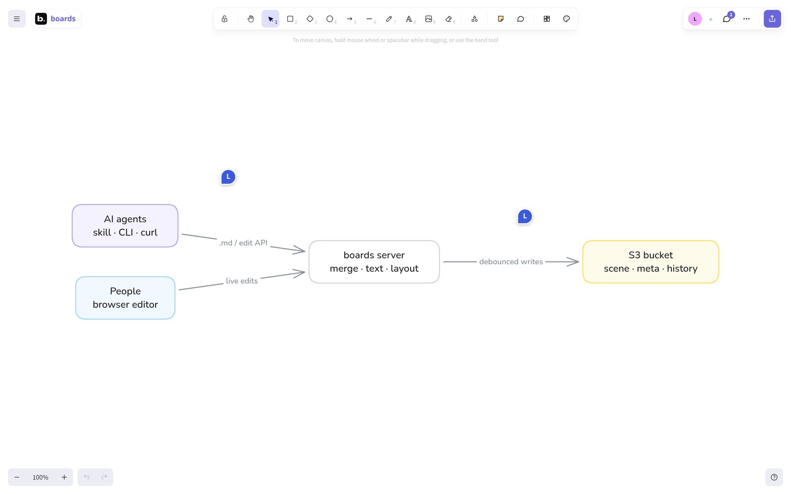
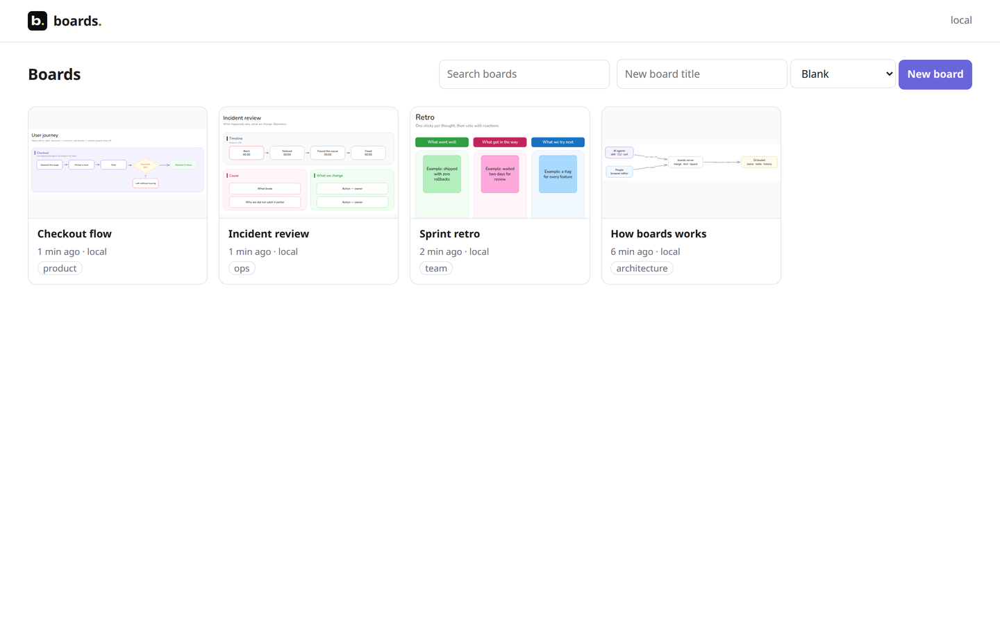

<p align="center">
  <picture>
    <source media="(prefers-color-scheme: dark)" srcset="docs/assets/wordmark-dark.svg">
    
  </picture>
</p>

<p align="center">
  <b>Whiteboards that people draw and AI agents read and edit.</b><br>
  A self-hosted Excalidraw editor with live collaboration, a text API for agents, and S3 storage.
</p>

<p align="center">
  <a href="LICENSE"></a>
  <a href="https://github.com/ly-solutions/boards/actions/workflows/ci.yml"></a>
  
</p>

<picture>
  <source media="(prefers-color-scheme: dark)" srcset="docs/assets/screenshots/editor-dark.png">
  
</picture>

## Why

Diagrams are where people explain systems to each other — and where AI agents are blind. Give an agent a
screenshot and it spends thousands of tokens guessing which way the arrows point; ask it to draw, and it produces an
image nobody can edit.

An Excalidraw scene already has the structure: shapes have labels, arrows are bound to the shapes at both ends.
boards serves that structure as text and accepts edits as JSON, on the same link people open in the browser:

```text
$ curl -s 'https://boards.example.com/b/how-boards-works-ijv5gljw1i2b.md?k=…'
# Board "How boards works"
## Shapes
- [people] rectangle "People / browser editor" (0,186 201×86) — fill white, stroke light blue
- [server] rectangle "boards server / merge · text · layout" (943,186 264×86) — fill white, stroke grey
- [s3] rectangle "S3 bucket / scene · meta · history" (1497,186 275×86) — fill white, stroke yellow
## Connections
- "People / browser editor" [people] → "Live channel / WebSocket" [live] — "edits, cursors"
- "boards server / merge · text · layout" [server] → "S3 bucket / scene · meta · history" [s3] — "debounced writes"
Slop check: clean, 5/100.
```

```sh
curl -s -X POST 'https://boards.example.com/b/how-boards-works-ijv5gljw1i2b/edit?k=…' \
  -H "Authorization: Bearer $BOARDS_TOKEN" -H 'content-type: application/json' \
  -d '{"graph":{"nodes":[{"id":"queue","label":"Queue"}],"edges":[{"from":"server","to":"queue"}]},"note":"add the queue"}'
```

The server lays the new nodes out, the edit appears live in every open editor, signed "edited by agent", and a
person can drag it around a second later.

## Features

- **Excalidraw editor** (the npm package, not a fork) with live collaboration over WebSocket — cursors, selection,
  follow mode, presence — and an HTTP polling fallback. Element-level merge by `version`/`versionNonce`, the rule
  Excalidraw itself uses, so browsers, pollers and agents converge on one scene.
- **Agent API**: the board as markdown with ids, edits as a node/edge `graph` (dagre layout), raw skeletons,
  updates and deletes; a **slop check** that scores a board for the tells of machine-drawn diagrams and names the
  elements at fault. A ready-made [agent skill](skills/boards/SKILL.md) for Claude Code and other agents.
- **Team features**: stickies with reactions, Figma-style comment threads (with a webhook), named checkpoints with
  diffs, a shared timer, templates (architecture, flow, retro, incident, decision, weekly, brainstorm), link cards.
- **Storage you already have**: any S3-compatible bucket (AWS, MinIO, Ceph, R2, Selectel, Yandex, B2, Wasabi …)
  with ETag-based optimistic concurrency and history via bucket versioning or immutable snapshots — or a local
  folder. Each board is a folder of plain files (`scene.excalidraw` opens in excalidraw.com).
- **Auth that fits**: API tokens for agents; for people a token sign-in form, any OIDC provider, a trusted reverse
  proxy, or none for local use. Safe by default.
- **Embeds and integrations**: read-only `?embed=1` view for iframes, oEmbed, one-time sign-in hand-off links,
  configurable CORS and `frame-ancestors` — see the [harnessly integration](docs/integrations/harnessly.md).
- **Plugins, not forks**: add rich cards for your tracker, actions on selected blocks, board properties, webhooks
  and per-person feature flags from a separate package mounted next to the stock image — see
  [docs/plugins.md](docs/plugins.md) and the [example plugin](examples/plugin-example/).
- **English and Russian** interface (`BOARDS_LOCALE`), message catalogs ready for more languages.
- **Runs anywhere**: one Node process; Docker image, docker compose with MinIO, Helm chart, Argo CD and kustomize
  examples, Prometheus metrics.

<picture>
  <source media="(prefers-color-scheme: dark)" srcset="docs/assets/screenshots/home-dark.png">
  
</picture>

## Quick start

```sh
git clone https://github.com/ly-solutions/boards.git && cd boards
docker compose up
```

Open <http://localhost:8080>, create a board, and hand its link to an agent. The compose file starts boards with
MinIO, authentication off and ports bound to localhost — copy `.env.example` to `.env` to turn auth on before
sharing it.

From an agent's shell (or yours):

```sh
export BOARDS_URL=http://localhost:8080
skills/boards/scripts/boards create "Checkout architecture" - <<'JSON'
{ "graph": { "nodes": [ { "id": "web", "label": "Web app" }, { "id": "api", "label": "API", "color": "blue" } ],
             "edges": [ { "from": "web", "to": "api", "label": "HTTPS" } ] } }
JSON
```

## Ways to run

| | |
| --- | --- |
| docker compose | `docker compose up` — boards + MinIO, bucket created on start |
| Docker | `docker run -p 8080:8080 -e BOARDS_API_TOKENS=… -e BOARDS_S3_BUCKET=… ghcr.io/ly-solutions/boards` |
| From source | `npm ci && npm run build && BOARDS_AUTH=none BOARDS_STORAGE=fs node bin/boards.mjs` (Node 22+) |
| Kubernetes | `helm install boards ./deploy/helm/boards` — [chart README](deploy/helm/boards/README.md) |
| Argo CD | [`deploy/argocd/application.yaml`](deploy/argocd/application.yaml) |
| kustomize | [`deploy/kustomize/base`](deploy/kustomize) |

Details, verified paths and operations notes: [docs/deployment.md](docs/deployment.md).

## Configuration

Environment variables only, validated at start-up; the full table is in
[docs/configuration.md](docs/configuration.md) (or run `boards config`). The ones you will set:

| Variable | Default | |
| --- | --- | --- |
| `BOARDS_PUBLIC_URL` | `http://localhost:8080` | origin users reach (links, cookies, OIDC, WebSocket origin) |
| `BOARDS_AUTH` | `token` | `token` · `oidc` · `proxy` · `none` |
| `BOARDS_API_TOKENS` | — | bearer tokens for agents (required in `token` mode) |
| `BOARDS_SESSION_SECRET` | random | cookie signing key — set it in production |
| `BOARDS_STORAGE` | `s3` if a bucket is set, else `fs` | storage driver |
| `BOARDS_S3_BUCKET`, `BOARDS_S3_ENDPOINT`, `BOARDS_S3_REGION`, `BOARDS_S3_FORCE_PATH_STYLE` | | S3 location; credentials from `BOARDS_S3_ACCESS_KEY_ID`/`…SECRET…` or the AWS chain (IRSA works) |
| `BOARDS_OIDC_ISSUER`, `BOARDS_OIDC_CLIENT_ID`, `BOARDS_OIDC_CLIENT_SECRET` | | OIDC sign-in |
| `BOARDS_FRAME_ANCESTORS`, `BOARDS_CORS_ORIGINS` | `'self'`, — | who may embed the editor / call the API from a browser |
| `BOARDS_LOCALE` | `en` | interface language: `en` · `ru` |
| `BOARDS_PLUGINS`, `BOARDS_WEB_PLUGINS`, `BOARDS_FLAGS` | — | [plugins](docs/plugins.md) and feature flags |
| `BOARDS_LINK_PREVIEW` | `off` | Open Graph previews for pasted links (SSRF-guarded) |

## Architecture

```
browser ── WebSocket /b/<slug>/live (edits, cursors) ─┐
browser ── POST /b/<slug>/sync every 1.5 s (fallback) ─┤
agent ──── GET /b/<slug>.md · POST /b/<slug>/edit ─────┼──▶ boards (one process, live state in memory)
workspace ─ iframe ?embed=1 · oEmbed · hand-off ───────┘          │ debounced writes, If-Match ETags
                                                                  ▼
                                    S3 bucket / folder: boards/<slug>/{scene.excalidraw, meta.yaml, board.md, …}
```

| Part | Where |
| --- | --- |
| HTTP routes, access rules | [`server/index.mjs`](server/index.mjs) |
| Live state, merge bookkeeping, debounced writes, checkpoints, history | [`server/store.mjs`](server/store.mjs), [`server/merge.mjs`](server/merge.mjs) |
| WebSocket live channel | [`server/live.mjs`](server/live.mjs), [`web/src/live.ts`](web/src/live.ts) |
| Board as text, slop check | [`server/summary.mjs`](server/summary.mjs), [`shared/slop.mjs`](shared/slop.mjs) |
| Agent edits: graph layout, skeletons | [`server/engine.mjs`](server/engine.mjs), Excalidraw under Node in [`engine/`](engine) |
| Storage drivers, snapshots, migration | [`server/storage/`](server/storage), [`server/migrate.mjs`](server/migrate.mjs) |
| Auth modes, configuration | [`server/auth.mjs`](server/auth.mjs), [`server/config.mjs`](server/config.mjs) |
| Editor | [`web/src/main.tsx`](web/src/main.tsx) and friends; render patches in [`scripts/excalidraw-patches.mjs`](scripts/excalidraw-patches.mjs) |
| Plugins: loader, cards, flags, SSRF guard | [`server/plugins.mjs`](server/plugins.mjs), [`server/cards.mjs`](server/cards.mjs), [`server/flags.mjs`](server/flags.mjs), [`server/ssrf.mjs`](server/ssrf.mjs), [`web/src/plugins.ts`](web/src/plugins.ts) |
| Interface language | [`shared/i18n.mjs`](shared/i18n.mjs), catalogs in [`shared/locales/`](shared/locales) |

Design notes — why the Excalidraw package plus our own storage instead of self-hosting excalidraw.com, how the
live channel recovers, checkpoints, embeds — are in [docs/design.md](docs/design.md). Storage internals and the
migration from git are in [docs/storage.md](docs/storage.md).

## API

Every instance serves an agent-oriented cheat sheet at `GET /b/api`. The full reference is in
[docs/api.md](docs/api.md); the integration contract (embedding, hand-off, JSON API, webhook) is in
[docs/integrations/harnessly.md](docs/integrations/harnessly.md).

## Development

```sh
npm ci
npm run build        # editor + server-side engine
npm run dev          # http://localhost:8080, no auth, boards in .data/
npm test             # node:test; S3 tests use MinIO in Docker when available, else an in-process fake
npm run lint         # typecheck the editor, parse every module, check docs/configuration.md is current
```

See [CONTRIBUTING.md](CONTRIBUTING.md). Security issues: [SECURITY.md](SECURITY.md).

## License

[Apache-2.0](LICENSE). Excalidraw is used as an npm dependency under the MIT license; see [NOTICE](NOTICE) and
[docs/licenses.md](docs/licenses.md) for third-party licenses.

boards is part of the [Ly Solutions](https://github.com/ly-solutions) open tools for people and coding agents
working side by side, alongside [harnessly](https://github.com/ly-solutions/harnessly).
